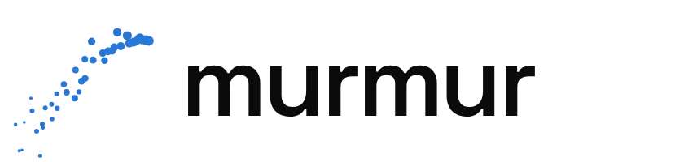
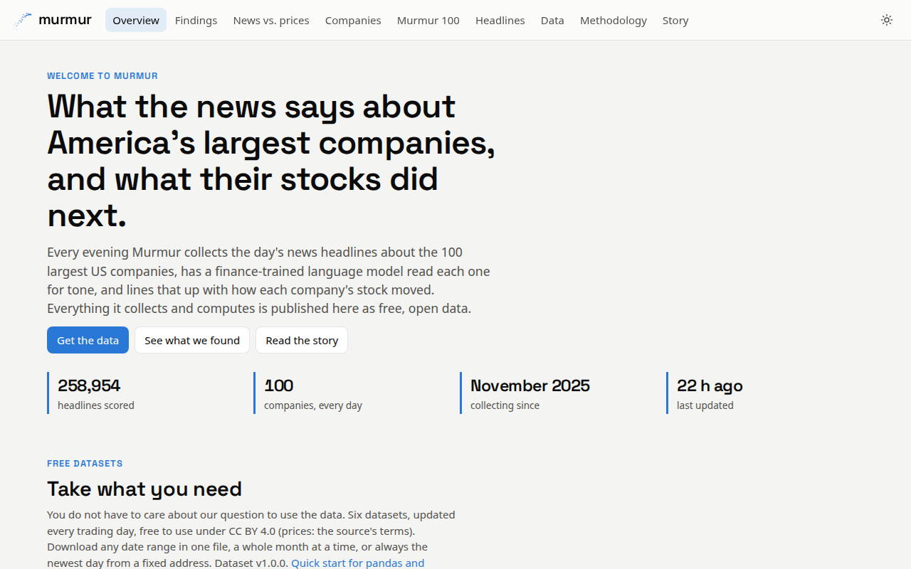
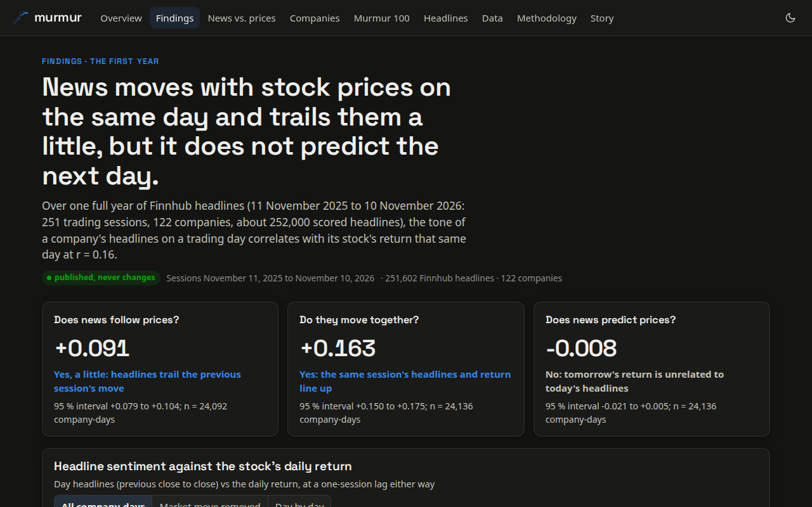
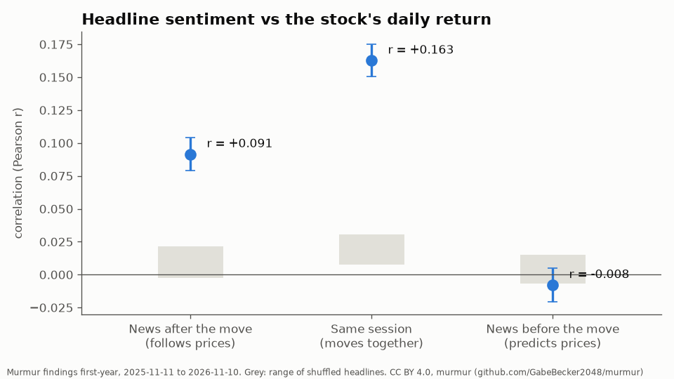

<div align="center">

<picture>
  <source media="(prefers-color-scheme: dark)" srcset="src/murmur/ui/static/brand/wordmark-dark.png">
  
</picture>

**Does news predict stock prices, follow them, or move with them?**

[](https://github.com/GabeBecker2048/murmur/actions/workflows/ci.yml)
[](https://github.com/GabeBecker2048/murmur/releases)
[](https://github.com/GabeBecker2048/murmur/pkgs/container/murmur)
[](LICENSE)
[](docs/dataset-card.md)
[](docs/stability.md)

</div>

<p align="center">
  <a href="docs/images/overview.png"></a>
  <a href="docs/images/findings-dark.png"></a>
</p>

<sub>The dashboard that comes with it: the overview, and the findings (dark theme).</sub>

**Every evening, Murmur reads the news about America's 100 largest companies and lines
it up with what their stocks did.** It collects each company's headlines, has FinBERT (a
language model trained on financial text) score their tone, pairs that with the stock's
overnight, intraday and daily returns, and asks whether the news came before the move,
with it, or after it. Everything it collects and computes is published as free, open
data, with a dashboard, an API and a feed on top.

- **Free datasets, updated daily.** Headlines with their sentiment scores, daily
  sentiment per company, the Murmur 100 (a free cap-weighted index of the 100 largest
  US companies, with its daily level), prices and returns, and every correlation.
  Parquet or CSV, any date range in one download, or always the newest day from a fixed
  address.
- **An answer, checked.** The findings are frozen and citable, and come with the tests
  that could have sunk them: the market's own move taken out, a day-by-day estimate,
  and headlines shuffled between companies.
- **A dashboard** for exploring it: every news window against every return at every
  lag, any company on its own or against another, the index, and a searchable archive
  of every scored headline.
- **Self-hosted in one compose file**: a daily pipeline with retries, backups, health
  checks and an HTTP API.

## What it found

From one full year of headlines (11 November 2025 to 10 November 2026, about 252,000
headlines, 251 trading sessions):



> **News moves with stock prices on the same day and trails them a little, but it does
> not predict the next day.** The same-day link (r = 0.16) is about the company, not the
> market's mood, and holds on 89 % of days; tomorrow's return is unrelated to today's
> headlines.

The reasoning, the checks and the caveats are on the dashboard's Findings page, and
every number is in `/data/findings/first-year.json`.

## Get the data

Everything is under `/data` on a Murmur server (`https://murmur.gabe.beer` below).

```sh
# the newest day of headlines, scored
curl -O https://murmur.gabe.beer/data/news/latest.articles.parquet

# any date range of any datasets, as one .tar.gz with licenses and checksums
curl -o murmur.tar.gz "https://murmur.gabe.beer/api/v1/bundle?from=2026-01-01&to=2026-06-30&datasets=sentiment,prices"
```

```python
import pandas as pd

index = pd.read_parquet("https://murmur.gabe.beer/data/m100/latest.constituents.parquet")
sentiment = pd.read_parquet("https://murmur.gabe.beer/data/sentiment/latest.sentiment.parquet")
```

Every finished month is also a ready-made archive, and `/data/index.json` lists every
file. The [quick start](docs/quickstart.md) covers pandas, DuckDB and the bundles.

## Run your own

Murmur runs as four small containers from one image: the dashboard and API, a
scheduler, the worker that runs the pipeline, and an optional offsite backup. Save
[`docker-compose.yml`](docker-compose.yml) in a new folder, then:

```sh
mkdir -p data/offsite config && touch config/murmur.toml
docker compose up -d
docker compose logs -f murmur-worker    # the first run downloads FinBERT (~440 MB)
```

The dashboard is on port 8100. The pipeline runs every evening at 18:00 New York time;
add a Finnhub key to `.env` (`MURMUR_FINNHUB_API_KEY`) for a second news source and
history backfills. Without Docker: `uv sync && uv run murmur serve`.

## Documentation

- **On the dashboard:** Overview, Findings, Methodology (how every number is made),
  Data, Story, and the API reference at `/docs`.
- [Quick start](docs/quickstart.md): reading the data with pandas and DuckDB
- [Data dictionary](docs/data-dictionary.md): every dataset, table and column
- [Dataset card](docs/dataset-card.md): what the data is, how it was collected, its
  limitations and licenses
- [Stability](docs/stability.md) and the [data changelog](docs/data-changelog.md): what
  v1.0.0 promises
- [Operating Murmur](docs/operating.md): the pipeline, configuration, backfills, jobs,
  deployment, backups
- [Configuration](docs/configuration.md) and [API](docs/api.md): every setting and route
- [CHANGELOG.md](CHANGELOG.md) and [ROADMAP.md](ROADMAP.md): what changed, and what is next
- [CITATION.cff](CITATION.cff): how to cite Murmur

## Contributing

Work happens on branches and lands through squash-merged pull requests. The project is
managed with [uv](https://docs.astral.sh/uv/):

```sh
uv sync --all-groups
uv run ruff check . && uv run ruff format --check .
uv run pytest                     # no network, no model download
```

## The people

Murmur started in 2023 as a side project between three friends, and was rebuilt into
what it is now in 2026. Read the story on the dashboard.

- Gabe Becker ([@GabeBecker2048](https://github.com/GabeBecker2048))
- Wyatt Burch-Celentano ([@wyatthbc](https://github.com/wyatthbc))
- Sam Chapoton ([@samchapoton](https://github.com/samchapoton))

## License

Code: MIT, see [LICENSE](LICENSE). Data: CC BY 4.0 for everything Murmur compiles or
computes; prices are republished under their source's terms. Headlines belong to their
publishers. FinBERT (`ProsusAI/finbert`) is used under its own license and not
redistributed. Space Grotesk is under the SIL Open Font License. Not investment advice.
